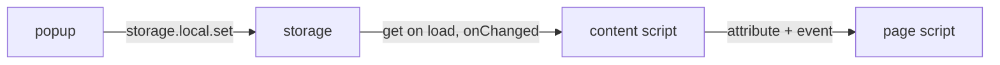

# Architecture

Slime is five small programs that run in different worlds, plus a build that
runs in Node. The layout makes a file's path say which world it runs in and
what it is allowed to call.

```
src/
  entrypoints/          what the browser runs; wiring only
    page.ts             Slite's page context, bundled as inject.js
    content.ts          content script: injects inject.js, relays settings
    popup/              the toolbar popup
    background/         chrome.ts (declarativeContent), firefox.ts (tabs)
  feature/              what Slime does
    fix/                the IME fixes, one per cause in root-causes.md
    extra/              opt-in additions, such as the Emacs keybindings
  settings/             what the popup, content script and page share
build/                  Node-side bundling and manifest generation
e2e/                    browser-driven check against a saved Slite page
```

## Three kinds of place

- **`entrypoints/`** says where code runs. An entry creates the parts it needs
  and connects them; it holds no rule of its own. A new screen or script is a
  new entry.
- **`feature/`** says what Slime does to Slite. `fix/` restores what Slite
  should have done (the reason the extension exists); `extra/` adds what
  Slite does not do. Whether a feature is on by default is a setting, not a
  place: both kinds can be switched off.
- **`settings/`** holds the values the user chooses, their defaults, and how
  they reach the page.

`build/` never ships in the extension, so it sits outside `src/`.

## Import direction

Only an entry imports from a parent directory. oxlint's
`no-relative-parent-imports` is on everywhere else, so `feature/` cannot
reach `settings/` or an entry: a feature receives what it needs (a predicate,
an enabled flag) from the entry that creates it.

## Settings flow

Storage is the only source of a setting, and its default lives in code
(`settings/settings.ts`), so nothing writes a default.



The page script cannot call extension APIs, so the content script relays the
value through a DOM attribute and a notification event
(`settings/page-channel.ts`). The page reads the attribute when it starts as
well as on each event, because it may run before or after the content script
has read storage.

## Browser differences

Every script calls `browser.*`, which Firefox has always had and Chrome has
had since 148 (`minimum_chrome_version` in the manifest). What still differs
is chosen at build time: the manifest fields in `build/manifest.ts`, and the
background script, which uses `declarativeContent` on Chrome and the `tabs`
API on Firefox.
